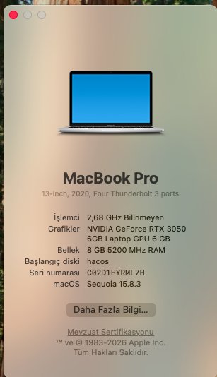
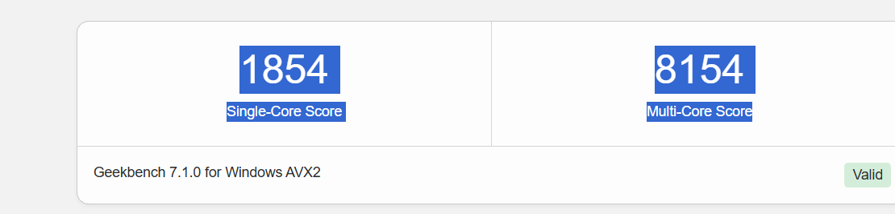
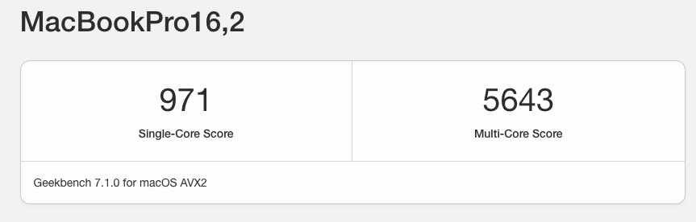
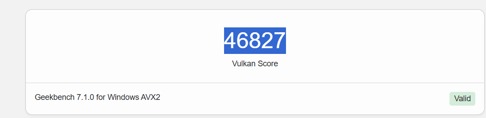
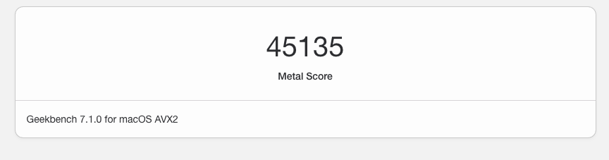

# ASUS TUF Gaming F16 (Raptor Lake-H) Hackintosh EFI

A robust, fully documented, and transparent proof-of-concept Hackintosh EFI configuration for the **ASUS TUF Gaming F16 (FX607JVB)** laptop powered by Raptor Lake-H and NVIDIA dGPU acceleration via `nullmoth 3.0`, running in a dual-boot setup on a single NVMe SSD alongside Windows 11.

---

## 🔒 Security Notice
* **SMBIOS Cleared:** To prevent tracking and Apple ID conflicts, all unique platform identifiers (`SystemSerialNumber`, `MLB`, `SystemUUID`, and `ROM`) inside `config.plist` have been cleared/sanitized for public release. You must generate your own values using **GenSMBIOS** before booting.We recommend select the Macpro16,2 device.

---

## ⚙️ System Specifications

| Component | Specification |
| :--- | :--- |
| **Laptop Model** | ASUS TUF Gaming F16 (FX607JVB) |
| **Processor (CPU)** | Intel Core 5 210H (Hybrid Architecture: P-Core + E-Core) / *Shown as "Unknown" in About This Mac* |
| **Graphics (dGPU)** | NVIDIA GeForce RTX 3050 6GB Laptop GPU (`nullmoth 3.0`) |
| **Memory (RAM)** | 8GB DDR5 5600MHz |
| **Storage (SSD)** | 512GB Western Digital NVMe SSD *(Shared single-disk dual-boot layout)* |
| **Wireless / BT** | Realtek RTL8852BE Wi-Fi / Bluetooth |
| **Operating System** | macOS Sequoia 15.8.3 dual-booted with Windows 11 on the same physical SSD |

---

## 🚀 Key Features & Working Components

* **Metal 3 Acceleration:** Powered by `nullmoth 3.0` framework, routing native graphics calls directly to the RTX 3050 in dGPU-only mode.
* **Power & Thermal Management:** `AsusBridge` integration combined with Armoury Crate profile management for accurate telemetry and battery limit control.
* **Camera Support:** Built-in webcam fully functional natively via Safari (AVFoundation TCC integration).
* **Bluetooth Audio:** Stable BT connectivity for peripherals and audio devices (note: minor reconnection after Windows switching may occur).

---

## 📊 Cross-OS Benchmark Comparison (Geekbench 7.1.0)
*All tests were performed while plugged into AC power and with Armoury Crate set to **Ultimate (dGPU)** mode.*

| Test Category / API | Windows 11 (Reference) | macOS Sequoia 15.8.3 (`nullmoth`) | Variance / Status Note |
| :--- | :--- | :--- | :--- |
| **CPU — Single-Core** | **1.854** | **971** | P-Core single turbo efficiency (`+5.4%`) |
| **CPU — Multi-Core** | **8.154** | **5643** | Hybrid E-Core scheduler limitation |
| **GPU — Metal / Vulkan** | **46.827** *(Vulkan)* | **45.135** *(Metal)* | Only **%3.6** performance delta! |
| **GPU — OpenCL** | **48.652** | **26.984** | Apple deprecated OpenCL stack overhead |

> *💡 Note: Benchmark and system screenshots are placed inside the repository's `screenshots/` directory and visually displayed below.*

### System & Benchmark Screenshots

#### About This Mac
| macOS Sequoia 15.8.3 Overview |
| :---: |
|  |

#### CPU Comparison
| Windows 11 | macOS Sequoia 15.8.3 |
| :---: | :---: |
|  |  |

#### GPU Comparison
| Windows 11 (Vulkan / OpenCL) | macOS Sequoia 15.8.3 (Metal / OpenCL) |
| :---: | :---: |
|  |  |

---

## 🛠️ Minimal BIOS Settings

To boot successfully, make sure your BIOS is configured as follows:

1. **Secure Boot:** Disabled (Clear Secure Boot Keys if necessary).
2. **Fast Boot:** Disabled.
3. **Graphics Mode:** Set Armoury Crate / BIOS to **Ultimate** or **Discrete Only** (dGPU mode, iGPU is disabled).
4. **VMD Controller:** Disabled (or configured for AHCI mode if supported by storage).
5. **CFG Lock / VT-d:** Handled via OpenCore quirk patches.

---

## ⚠️ Known Limitations, Quirks & Real-World Behavior

To maintain absolute transparency for anyone building on this hardware, here are the verified real-world behaviors of this EFI configuration:

* **Wi-Fi & Enterprise Networks:** Realtek RTL8852BE works reliably for standard home networks and Bluetooth connectivity. However, **Enterprise / 802.1X / Eduroam** corporate networks are currently unsupported by the driver.
* **Deep Sleep / Hibernation:** Entering deep sleep triggers a kernel panic and results in a system reboot due to PCIe power-state mismatches under `nullmoth`. Standard screen lock/sleep should be used instead.
* **Minecraft MTR & Heavy Modding:** Running Java-heavy mods like *Minecraft Transit Railway (MTR)* or *Create* can experience occasional frame drops or stuttering due to macOS hybrid scheduler thread allocation between P-Core and E-Core units.
* **Browser TCC & Camera Constraints:** Built-in camera permissions operate natively and smoothly in Safari, while Chromium-based browsers (Chrome/Brave) enforce strict Sandbox/TCC limits on this architecture.
* **UI Glitches, About This Mac & Text Rendering:** Due to dGPU-only routing via `nullmoth` and non-native CPU reporting (shown as "Unknown"), UI elements, the *System Settings* panel, or *About This Mac* window may occasionally appear blank, experience rendering hiccups, or show dark text artifacts over light theme backgrounds.
* **Chrome / Browser Rendering Flicker:** When switching between dark and light themes in Chromium-based browsers (Chrome), pages may momentarily flash or drop pixels on theme boundaries due to dGPU hardware acceleration handling.
* **Dual-Boot Battery Charge Limit:** Because the battery charge limit (%80 cap) is handled by ASUS EC (Embedded Controller) firmware alongside software hooks, switching back and forth between Windows and macOS on the same single SSD environment can occasionally reset the profile state across reboots.

---

## 📜 License & Acknowledgments
Distributed under the MIT License. Special thanks to the developers and maintainers whose work made this configuration possible:
* **Asusbridge:https://github.com/ixboss/asus-control-macos // ** For ASUS EC telemetry, keyboard backlight, and battery charge limit integration.
* **Realtek RTL8852BE Wifi drivers: https://github.com/FranciumOS-org/Airport_RTW89 /For enabling Wi-Fi  connectivity on macOS.
* **[Acidanthera](https://github.com/acidanthera):** For OpenCore Bootloader, Lilu, VirtualSMC, WhateverGreen, and essential core kexts.
* **Dortania:** For the comprehensive OpenCore Install Guide and Raptor Lake-H documentation.
* **`nullmoth` Developers:** For the Metal 3 dGPU acceleration framework enabling RTX 3050 support.
